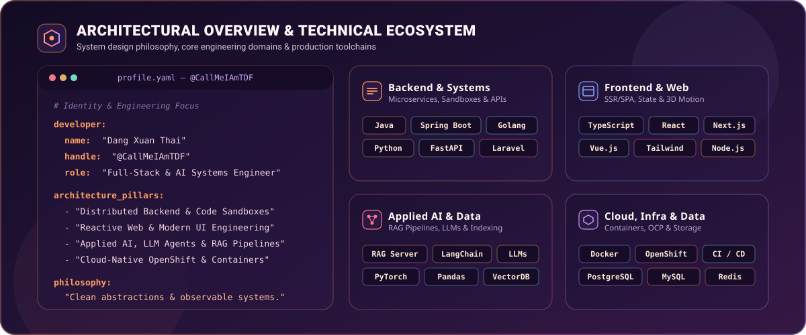
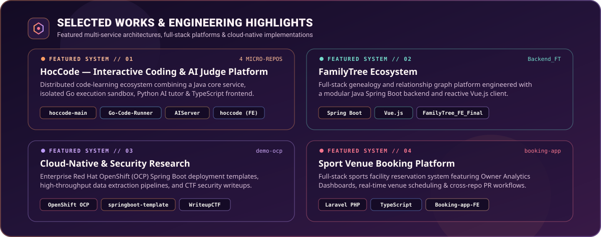

<!-- 01. HERO BANNER: Lo-fi Sunset / Dusk Animated Canvas -->

 

<!-- TYPING MOTION SUBTITLE -->

 

<!-- CONTACT & QUICK NAVIGATION PILLS (SimpleIcons Vector Library) -->

&nbsp;

&nbsp;

  

<!-- 02. ARCHITECTURAL OVERVIEW & TECHNICAL ECOSYSTEM (Unified Dusk SVG Canvas) -->

  

<!-- SKILLICONS VECTOR DOCK -->

  

<!-- 03. TOP 5 CORE LANGUAGES & CONTRIBUTION TELEMETRY (Auto-Updated via GitHub Actions) -->

  

<!-- 04. SELECTED WORKS & ENGINEERING HIGHLIGHTS (Unified Dusk SVG Canvas) -->

 

<!-- DIRECT REPOSITORY LINKS FOR SELECTED WORKS -->

&nbsp;

&nbsp;

&nbsp;

  

<!-- 05. FOOTER WAVE: Animated Lo-fi Sunset Horizon -->

