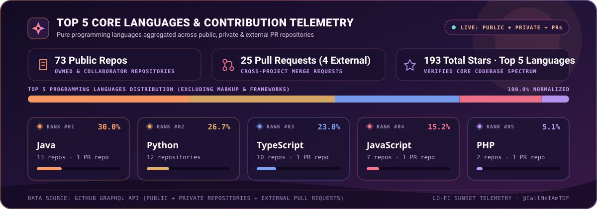
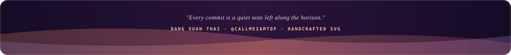

<div align="center">

<!-- HERO BANNER: Custom Animated Lo-fi Sunset / Dusk SVG -->


<br />

<!-- TYPING MOTION SUBTITLE -->
<a href="https://github.com/CallMeIAmTDF">
  
</a>

<br />

<!-- CONTACT & IDENTITY LINKS (SimpleIcons SVG Library — Zero Emoji Substitution) -->
<a href="https://github.com/CallMeIAmTDF">
  
</a>
&nbsp;
<a href="mailto:dang.xuan.thai@vsi-international.com">
  
</a>
&nbsp;
<a href="https://github.com/CallMeIAmTDF?tab=repositories">
  
</a>

</div>

<br />


## Overview

```yaml
developer:
  name: "Dang Xuan Thai"
  handle: "@CallMeIAmTDF"
  focus:
    - "Distributed Backend Architecture (Java / Spring Boot, Python / FastAPI, Go)"
    - "Full-Stack Web Engineering (TypeScript, React, Next.js, Vue.js)"
    - "Applied AI, Retrieval-Augmented Generation (RAG) & Data Engineering"
    - "Cloud Infrastructure, Containerization & DevSecOps"
  philosophy: "Clean abstractions, observable systems, and thoughtful craftsmanship."
```


## Technical Ecosystem

> All technology badges below are rendered strictly through **SkillIcons** and **SimpleIcons** vector libraries rather than inline emoji replacements.

<div align="center">

<table>
  <thead>
    <tr>
      <th align="left" width="220">Domain</th>
      <th align="left">Core Technologies &amp; Tooling</th>
      <th align="left" width="260">Architectural Focus</th>
    </tr>
  </thead>
  <tbody>
    <tr>
      <td><strong>Backend &amp; Systems</strong></td>
      <td>
        
      </td>
      <td>Microservices, REST/GraphQL APIs, High-Concurrency Workers, Auth &amp; Security</td>
    </tr>
    <tr>
      <td><strong>Frontend &amp; Web</strong></td>
      <td>
        
      </td>
      <td>SSR/SPA Architecture, Design Systems, State Management, WebGL / 3D Motion</td>
    </tr>
    <tr>
      <td><strong>AI &amp; Data Pipelines</strong></td>
      <td>
        
        
        
        
        
      </td>
      <td>LLM Orchestration, Legal/Domain Chatbots, Vector Indexing, Data Extraction</td>
    </tr>
    <tr>
      <td><strong>Databases &amp; Storage</strong></td>
      <td>
        
      </td>
      <td>Relational Modeling, Query Optimization, Distributed Caching, Event Stores</td>
    </tr>
    <tr>
      <td><strong>Cloud &amp; DevOps</strong></td>
      <td>
        
      </td>
      <td>Container Orchestration, CI/CD Automation, OpenShift / OCP, Reverse Proxies</td>
    </tr>
  </tbody>
</table>

</div>


## Deep Language & Contribution Telemetry

<div align="center">

<!-- AUTO-GENERATED MULTI-SOURCE LANGUAGE SPECTRUM CARD (Owned Public + Private + External PRs) -->


</div>

> [!NOTE]
> **Multi-Source Aggregation**: Unlike standard profile widgets that only inspect public owned repositories, [`assets/languages-sunset.svg`](./assets/languages-sunset.svg) is generated by [`scripts/update-stats.js`](./scripts/update-stats.js) via GitHub's GraphQL & REST APIs to aggregate **owned repositories (Public + Private)**, **collaborator projects**, and **external repositories contributed to via Pull Requests / Merge Requests**.


## Selected Works & Engineering Highlights

<table>
  <tr>
    <td width="50%" valign="top">
      <h3><a href="https://github.com/CallMeIAmTDF/lawbot">Lawbot &amp; RAG Server</a></h3>
      <p>Domain-specific intelligent legal assistant pairing a <strong>Spring Boot (Java)</strong> core service, a <strong>Python RAG pipeline</strong> (<a href="https://github.com/CallMeIAmTDF/RAG-SERVER"><code>RAG-SERVER</code></a>), and a modern <strong>TypeScript</strong> web client (<a href="https://github.com/CallMeIAmTDF/lawbot-ui"><code>lawbot-ui</code></a>).</p>
      <p>
        
        
        
        
      </p>
    </td>
    <td width="50%" valign="top">
      <h3><a href="https://github.com/CallMeIAmTDF/Backend_FT">FamilyTree Ecosystem</a></h3>
      <p>Full-stack genealogy and relationship management platform engineered with a modular <strong>Java Spring Boot</strong> backend (<a href="https://github.com/CallMeIAmTDF/Backend_FT"><code>Backend_FT</code></a>) and a reactive <strong>Vue.js</strong> frontend (<a href="https://github.com/CallMeIAmTDF/FamilyTree_FE_Final"><code>FamilyTree_FE_Final</code></a>).</p>
      <p>
        
        
        
      </p>
    </td>
  </tr>
  <tr>
    <td width="50%" valign="top">
      <h3><a href="https://github.com/CallMeIAmTDF/booking-app">Sport Venue Booking Platform</a></h3>
      <p>Cross-repository contribution and feature engineering (Owner Dashboard, Real-time Venue Telemetry &amp; Booking Workflows) built with <strong>Laravel (PHP)</strong> and <strong>TypeScript / React</strong> (<a href="https://github.com/CallMeIAmTDF/Booking-app-FE"><code>Booking-app-FE</code></a>).</p>
      <p>
        
        
        
      </p>
    </td>
    <td width="50%" valign="top">
      <h3><a href="https://github.com/CallMeIAmTDF/demo-ocp">Cloud-Native &amp; Security Research</a></h3>
      <p>Enterprise <strong>OpenShift (OCP)</strong> Spring Boot templates (<a href="https://github.com/CallMeIAmTDF/demo-ocp"><code>demo-ocp</code></a>, <a href="https://github.com/CallMeIAmTDF/springboot-template"><code>springboot-template</code></a>), high-speed data processing (<a href="https://github.com/CallMeIAmTDF/chuyen_du_lieu_sao_ke"><code>chuyen_du_lieu_sao_ke</code></a>), and CTF security writeups (<a href="https://github.com/CallMeIAmTDF/WriteupCTF"><code>WriteupCTF</code></a>).</p>
      <p>
        
        
        
      </p>
    </td>
  </tr>
</table>


<!-- FOOTER WAVE: Custom Animated Lo-fi Sunset SVG -->
<div align="center">
  
</div>

